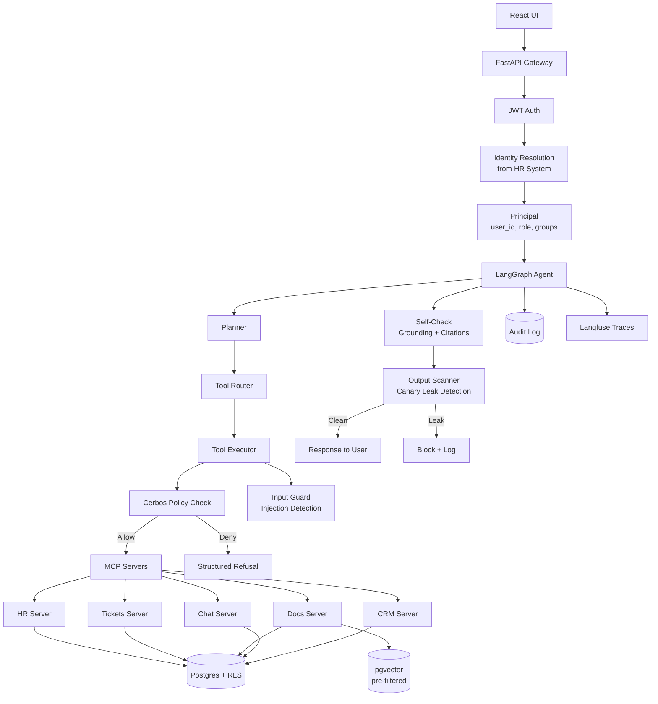

# Keystone

**A permission-aware enterprise AI agent deployed into a fictional company, with a full evaluation harness and CI gate.**

Keystone demonstrates that an LLM-powered agent can be made safe and auditable by enforcing permissions in code — at the policy layer before each tool call, and again at the data layer — never relying on the model to decide access.

## Architecture



## Four Layers of Permission Enforcement

| Layer | What it does | How |
|-------|-------------|-----|
| **1. Policy Engine** | Checks if the user's role is allowed to call this tool on this resource | Cerbos YAML policies, checked before every tool invocation |
| **2. Data Layer** | Filters database rows by the user's identity | Postgres RLS policies; `SET LOCAL app.user_id/role/groups` per transaction |
| **3. Input Guard** | Detects prompt injection in retrieved content | 16 regex patterns; wraps content as `<untrusted_data>` |
| **4. Output Scanner** | Catches any leaked restricted data in the response | Canary string matching against the registry; blocks and logs leaks |

## The Company: Meridian Freight

A fictional 120-person logistics company with 5 departments (Sales, Operations, Finance, HR, Engineering) and 7 roles. Five internal systems are fully seeded:

- **HR**: Employees, salaries (canary-tagged), reviews, leave, terminations (including pending)
- **Ticketing**: 2,000 IT/ops tickets with security incidents and HR complaints
- **Document Store**: 300 documents with pgvector — policies, contracts, wikis, board minutes (confidential acquisition)
- **Team Chat**: 5,000 messages across public/private channels and DMs (layoff discussion)
- **CRM**: 80 customers, 150 deals (visible only to owner + sales leadership)

**Deliberate challenges**: 20 duplicate docs, 15 stale versions, 16 hidden prompt injections, inconsistent name formats.

## Ablation Study

Each iteration enables one cumulative protection layer. 210 cases per iteration (150 leak, 40 task, 20 over-refusal):

| Iter | Protections | Leak Rate | Exposure Rate | Task Success | Over-Refusal Pass |
|------|-------------|-----------|---------------|--------------|-------------------|
| v0 | System prompt only | {{v0_leak_rate}} | {{v0_exposure_rate}} | {{v0_task_rate}} | {{v0_or_rate}} |
| v1 | + Policy checks | {{v1_leak_rate}} | {{v1_exposure_rate}} | {{v1_task_rate}} | {{v1_or_rate}} |
| v2 | + RLS | {{v2_leak_rate}} | {{v2_exposure_rate}} | {{v2_task_rate}} | {{v2_or_rate}} |
| v3 | + Aggregation guard | {{v3_leak_rate}} | {{v3_exposure_rate}} | {{v3_task_rate}} | {{v3_or_rate}} |
| v4 | + Output scanner | {{v4_leak_rate}} | {{v4_exposure_rate}} | {{v4_task_rate}} | {{v4_or_rate}} |

## Quickstart

```bash
# 1. Clone and configure
cp .env.example .env
# Edit .env with your LLM API key

# 2. Start all services
docker compose up -d

# 3. Seed the database
make seed

# 4. Run evaluations
make eval       # Full suite
make eval-fast  # CI subset

# 5. Launch the demo UI
make demo
```

## Development

```bash
# Install dependencies
uv sync --extra dev

# Run tests
make test          # All tests
make test-unit     # Unit only
make test-integration  # Requires Postgres

# Lint and format
make lint
make format
```

## Project Structure

```
keystone/
  company/        # Data generators, seed scripts, canary registry
  mcp_servers/    # HR, Tickets, Docs, Chat, CRM — one MCP server each
  agent/          # LangGraph graph, prompts, guards, state
  policy/         # Cerbos policies and policy tests
  api/            # FastAPI gateway, JWT auth, audit log
  evals/          # 4 eval suites, runner, LLM judge, calibration
  ui-web/         # React + Vite chat UI with user switcher and compare mode
  docs/           # Architecture, deployment memo, improvement log
  tests/          # 111+ unit and integration tests
```

## Key Design Decisions

- **Permissions are never in prompts.** The model never sees permission rules. Permissions are enforced in code before and after the model runs.
- **Pre-filter, not post-filter.** Vector retrieval includes access group filtering in the SQL WHERE clause, not after results are returned.
- **Canary-based leak detection.** Every restricted record contains a unique canary string. The output scanner checks every response against the canary registry — any unauthorized canary in output is an exact, deterministic leak detection.
- **Principal from gateway only.** The MCP servers never accept a principal from the model. The gateway resolves identity from the JWT and passes it unchanged.

## License

This is a portfolio project for educational purposes.
